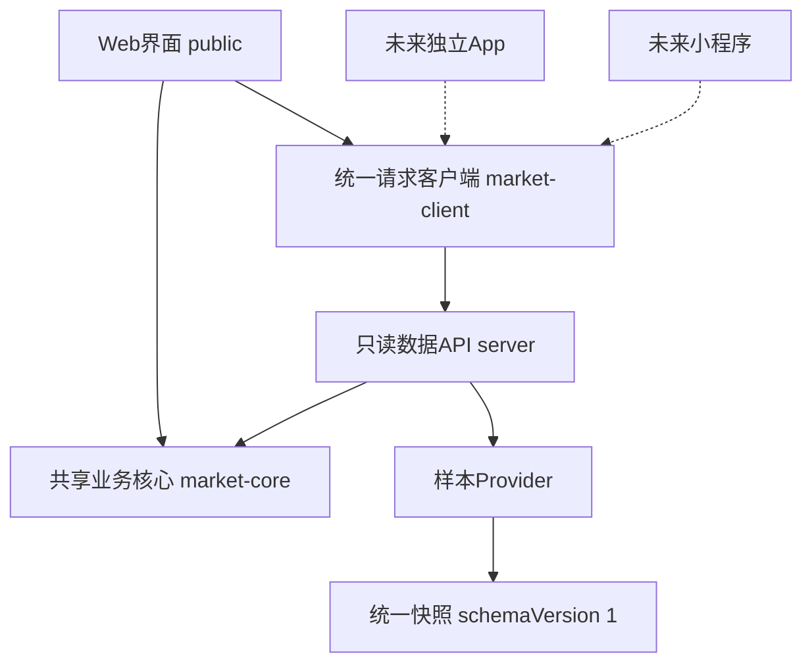

# 源码结构与开发边界

当前交付为可运行 Web 页面、Node 数据服务、共享业务核心、跨端请求 SDK、内置样本与测试。独立 App 和小程序的页面工程尚未构建，接入基础已提供。



| 位置 | 负责什么 | 修改场景 |
| --- | --- | --- |
| `public/index.html`、`style.css` | Web结构和基础样式 | 重新设计界面 |
| `public/ui.config.js`、`theme-overrides.css` | 公开的主题、布局、文字、模块配置及样式覆盖 | 日常UI修改入口 |
| `public/market-map.js` | Web Canvas布局与绘制 | 改图形呈现；不写数据获取逻辑 |
| `public/app.js` | Web交互及页面装配 | 改交互流程 |
| `public/data.config.js`、`data-source.js` | Web数据接入与显式样本兜底 | 换服务地址、选择样本/API模式 |
| `packages/market-core/index.js` | 无DOM、无网络、无文件依赖的归一化、池、查询和详情关联 | 多端共同业务规则 |
| `packages/market-client/index.js` | 统一只读请求、Fetch/微信适配和错误约定 | 多端访问同一服务 |
| `server/create-server.cjs`、`api.cjs` | 静态服务和JSON API | 服务协议与路由 |
| `server/providers/sample-provider.cjs` | 读取受信任的本地样本 | 将来增加实际数据Provider |
| `public/data/` | 原始版本内置样本 | 更新样本；保留真实日期 |
| `public/shared/`、`dist/sdk/` | 由共享源码生成的浏览器及SDK副本 | 运行 `npm run build`，不要手工编辑 |
| `examples/` | 可运行Fetch例子及小程序适配例子 | 端接入起点 |
| `tests/` | 业务、接口、客户端、UI配置和页面回归 | 验证行为 |
| `scripts/build.cjs`、`check.cjs` | 生成共享副本、检查语法和副本一致性 | 构建与交付 |

## 开发命令

```powershell
npm ci
npm run build
npm run check
npm test
npm start
```

仓库保留了已生成副本与本地D3分发文件，因此启动当前样本系统只需 Node.js 20+ 和 `node server.js`。修改共享核心或SDK后运行build；修改UI配置和CSS后刷新页面。`npm run dev` 使用Node的服务端文件监听；Web静态文件仍以刷新方式查看。

## 继续接入数据

Provider 接口只有 `loadSnapshot()`，返回快照或Promise。服务通过 `createServer({provider})` 注入它，核心和客户端不绑定上游网站。请直接实现新的JSON数据适配器，保留 `schemaVersion/meta`，不要把远端脚本交给样本Provider执行。

当前Provider只读取仓库内8个受信任的赋值型fixture，并缓存一次。现有Web在HTTP下默认访问API；直接用file地址打开则使用内置样本。API不可用时是否允许样本兜底由数据配置决定，兜底会标记在 `MarketRuntime`，页面数据日期提示也会说明。实时行情、用户账户与实际交易均未实现。

UI改法见 [UI_EDITING.md](UI_EDITING.md)，接口见 [API.md](API.md)，未来端接入见 [PLATFORM_PLAN.md](PLATFORM_PLAN.md)。
